# Dynamic Hallucination detection for LLMS

**Shreshtha Modi**  
Independent

**For**  
Lexsi Labs AI Alignment and Safety Hackathon

## Abstract

This project introduces a real-time, low latency framework for detecting hallucination across hindi language and multi-turn long form LLM generated answers in real time and reducing it by removing a hallucination direction from the model's activations. We train token-level detectors on the hidden states of Llama 3.1 8B and Aya Expanse 8B that flag hallucinated entities (names, dates, numbers, citations) while the answer is being generated, and we use Lexsi Labs' SafeTune to find and remove the hallucination direction in the middle layers, with the datasets curated through CuratorKit. In Hindi, both models hallucinate more than an English control (40.2% and 43.6% of entities, against 32.3%), and in three-turn conversations Llama's hallucinated entities rise from 27% at the first turn to 64% at the third. Our best detectors reach a held-out span-max AUC of 0.73 in Hindi (Aya) and 0.84 in multi-turn conversations (Llama), against 0.68 and 0.61 for next-token entropy. Removing the direction from Aya lowers hallucinated entities in answers to new Hindi prompts from 61.9% to 47.8% (−14.2 points, 95% CI −22.7 to −3.9), with no refusals, a KL divergence of 0.02 nats per token and answers of nearly the same length. We release the Hindi and multi-turn datasets, the trained detectors, the hallucination directions and a live demo that shades every word by its probe score.

## Submission summary
This write-up is our submission to the Lexsi Labs hackathon. The table below lists the links the submission asks for and the headline before-and-after numbers; Section 3.4 explains why we chose these metrics, Section 3.5 the datasets, tasks and models, Section 3.6 how the Lexsi Labs libraries fit into the pipeline, Section 4.5 what the result changes for a user, and Section 4.6 the cost comparison with a closed-source model.

|                                  |                                                                                                                                                                                                                                               |
|----------------------------------|-----------------------------------------------------------------------------------------------------------------------------------------------------------------------------------------------------------------------------------------------|
| **Problem**                      | Detect hallucinated entities in long-form LLM answers while they are generated, in Hindi and across multi-turn conversations, and reduce them without retraining the model.                                                                   |
| **Models**                       | Llama 3.1 8B Instruct and Aya Expanse 8B (open weights, kept frozen); Llama 3.2 3B Instruct as the English control.                                                                                                                           |
| **Lexsi Labs libraries**         | **CuratorKit** for dataset curation and provenance (Section 3.1); **SafeTune** for finding, steering and removing the hallucination direction (Section 3.3); **AlignTune** as the post-training route for our labels (Sections 3.6 and 5).    |
| **Before → after (model)**       | Aya Expanse 8B, direction removed with SafeTune: hallucinated entities in new Hindi answers 61.9% → 47.8% (−14.2 points), Not Supported only 50.8% → 40.4%, refusals 0% → 0%, length 2,994 → 2,934 characters, KL 0.019 nats/token (Table 3). |
| **Before → after (detection)**   | Next-token entropy (no training) → our best trained detector, span-max AUC: Hindi Aya 0.681 → 0.732, multi-turn Llama 0.612 → 0.836; recall at 10% FPR 0.22 → 0.52 on multi-turn Llama (Table 1).                                             |
| **Public code**                  | [https://github.com/shreshtha48/Hallucination-detection](https://github.com/shreshtha48/Hallucination-detection)                                                                                                                       |
| **Live demo (HF Space)**         | **\[add the Space URL before submitting\]** Gradio app in demo/ of the repository; it streams an answer and shades every word by its probe score (Section 3.7).                                                         |
| **HF Article**                   | **\[add the Hugging Face article URL before submitting\]**                                                                                                                                                              |
| **Datasets, probes, directions** | [https://huggingface.co/shreshtha2002/hallucination-probes-multiturn](https://huggingface.co/shreshtha2002/hallucination-probes-multiturn) and the dataset links under Code and Data.                                                  |
| **Cost (Section 4.6)**           | Self-hosted 8B model with the probe on one L4: about \$0.74 per million output tokens with batched serving (estimate), against \$10 for GPT-5 and \$30 for GPT-5.5.                                                                           |

*Table 1. Detection before and after: next-token entropy, which needs no training, against our best trained detector in each run (chosen by held-out span-max AUC, as in Tables A2–A6).*

| **Run**                            | **Best trained detector** | **Span-max AUC** | **Recall at 10% FPR** | **Best-threshold accuracy** |
|------------------------------------|---------------------------|------------------|-----------------------|-----------------------------|
| **Hindi · Aya Expanse 8B**         | Logistic regression, L14  | 0.681 → 0.732    | 0.20 → 0.33           | 0.66 → 0.68                 |
| **Hindi · Llama 3.1 8B**           | Difference of means, L14  | 0.639 → 0.691    | 0.31 → 0.29           | 0.67 → 0.67                 |
| **Multi-turn · Aya Expanse 8B**    | MLP probe, L18            | 0.685 → 0.812    | 0.24 → 0.42           | 0.69 → 0.77                 |
| **Multi-turn · Llama 3.1 8B**      | Logistic regression, L13  | 0.612 → 0.836    | 0.22 → 0.52           | 0.60 → 0.77                 |
| **English control · Llama 3.2 3B** | Logistic regression, L11  | 0.731 → 0.781    | 0.30 → 0.38           | 0.71 → 0.74                 |

## 1. Introduction
Since the widescale adoption of LLMs, people have been relying on them to verify information, get recommendations and even take advice. According to an article published by the online site called AI weekly, roughly 81% of their 816 researchers surveyed now use LLMS as a part of their research and one of the biggest issues that comes with the normalization of LLM usage is developing an understanding of how to spot hallucinated content.

This project aims at understanding how to spot hallucinations in LLMS while generating responses using several white-box and grey-box techniques such as linear probing, spectral clustering. Much work has already been done for the English language in a single turn setting for smaller tasks which can be split into atomic claims. We recommend a framework for tackling hallucination in low resource languages and in a multi-turn setting for long form generation

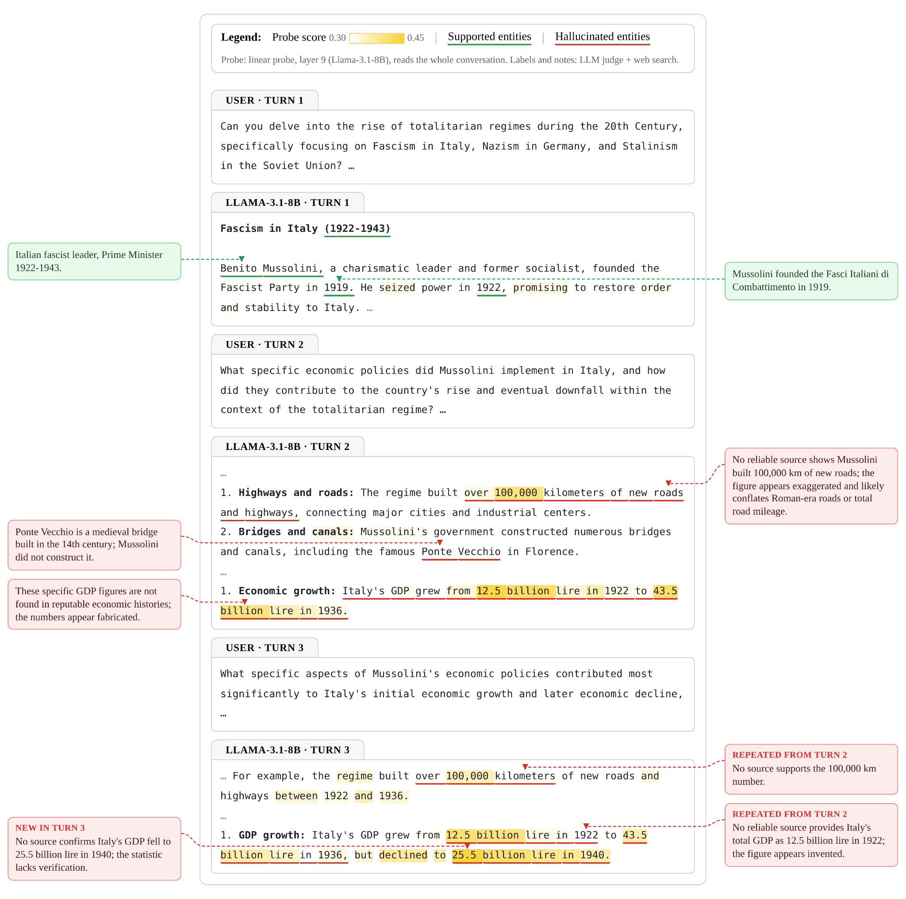

We study two models in Hindi, Llama 3.1 8B and Aya Expanse 8B, and find that both tend to hallucinate more in Hindi than in English (40% and 44% of the entities they mention, against 27% and 34% in English). Hindi answers are also much sparser, with only 6-10 entities per answer, and here simpler methods such as logistic regression work as well as or better than the trained linear probe. We also find a hallucination direction in the middle layers of both models. Removing it lowers Aya's hallucinated entities in Hindi by 14 points, without refusals or loss of fluency

In conversations simulating real-world multi-turn use, we found that hallucination grows as the user asks more follow-up questions. For Llama, the share of hallucinated entities rises from 27% in the first turn to 64% in the second and third; for Aya it rises from 34% to 40% by the third turn.

We release multi-turn and Hindi versions of LongFact with entity-level hallucination labels, together with trained detectors namely: linear and non-linear (MLP) probes, attention-head probes, logistic-regression and difference-of-means classifiers, and the hallucination directions used for steering

## 2. Related Work

There is a lot of work done on hallucination detection, among them probe based methods have been something that have shown promise and something that we are focusing on

**Probe-based hallucination detection.** An LLM’s hidden states contain information about whether its output is true. Kadavath et al. (2022) showed that models can partly predict whether they know an answer. Azaria and Mitchell (2023) trained classifiers on hidden states to separate true from false statements, and Orgad et al. (2024) found that models often encode the correct answer internally while generating a wrong one. Kossen et al. (2024) trained probes to predict semantic entropy, which removes the cost of sampling many answers that semantic entropy itself needs (Farquhar et al., 2024). Black-box methods instead compare several sampled answers (Manakul et al., 2023), or split an answer into atomic claims and verify each one against Wikipedia (Min et al., 2023) or with web search (Wei et al., 2024). These methods are accurate but need many extra calls per answer, so they can’t run in real time.

Obeso et al. (2025) target entity-level hallucinations, such as fabricated names, dates and citations, in long-form generation, label them at the token level with a web-search annotator, and train linear probes that flag them as the model generates. Han et al. (2025) probe long-form generation at the level of atomic claims, and Liang and Wang (2025) replace the linear probe with an MLP probe. All three study English, single-turn answers only.

**Multilingual hallucination.** Halluverse-M3 reports that detection is weakest in Hindi. These benchmarks measure model behaviour, not internals. Two recent papers probe internals across languages: Alansari et al. (2026) for Arabic and English, and Singh (2026) for English, Hindi and Hinglish. Both find that hallucination signals largely transfer across languages. However, both use short-form question answering with one label per answer.

**Multi-turn hallucination.** LLMs perform worse in multi-turn conversations than in single-turn ones and rarely recover from early mistakes (Laban et al., 2025). In multi-turn hallucination benchmarks, turn position affects hallucination rates (Fan et al., 2026; Chen et al., 2024).Jara-Mikolajczak et al. (2026) show that linear probes trained on single turns stay accurate in long sequential question answering. He et al. (2025) find early evidence that probes can predict when a model will change its answer under follow-up questions. These studies use short-form answers checked by exact match, or answer changes, rather than long-form answers with web-verified entity labels.

We found no prior work that tests token-level hallucination probes on long-form generation in Hindi or across multi-turn conversations. We also found none that compares a multilingual model with an English-centric one in the same setup.

## 3. Methods

### 3.1 Data Generation and Annotation

Our project builds on the work of Obesto Et Al where they used entity-level hallucination detection for long form data, this has been tested to be better than span level hallucination detection because of the stream of token generation by the models. However, they only tested it on single turn conversation making it difficult to test against real world scenarios as they often tend to consist of multi turn conversation between the user and assistant.

To simulate the same, we have built a multi- turn long form dataset which takes on the prompts from the longfact data and gives them onto our target llm to answer, we have a follow up writer that takes turn mimicking users asking the target llm more questions about the same topic creating a multi-turn dataset which is then annotated by an judge llm with websearch capabilities into supported, not supported and insufficient. Here arguments,entities, facts, figures etc are categorized as supported if we find the evidence of their correctness, unsupported if we can't verify the given claim and insufficient otherwise. Insufficient was particularly important here because we did not have access to better frontier models and upon verifying a small sample (n=10) by hand we discovered that labels given by the llm judge matched the labels given by humans 78% of the times. Here the accuracy of the model responses could be improved by having more sophisticated mcp servers, increasing the sample size and the model family (claude has been shown to give promising results, we plan to include claude sonnet as a judge during extension)

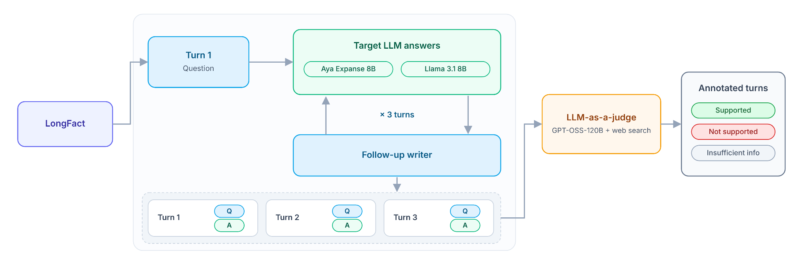

We also introduce a hindi version of the long fact dataset which was translated using sarvam’s open source model. We gave the original data to the translator and then passed that onto our target model, thereby annotating the answers given by the model using GPT-0SS-120B with web search (duck duck go search) capabilities to get our annotated dataset. Another approach could also be retrieval using static sources such as fact set, however they tend to increase the latency by a lot so we chose to not approach the same

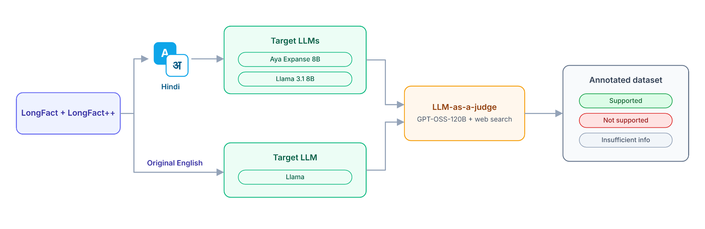

For both of our tasks we chose our target models to be Llama 3 8B instruct (Llama 3.1 8B Instruct, which has shown good promise, has been studied widely (Grattafiori et al., 2024, Obeso et al. (2025) and has multilingual support and Aya expense 8B (Dang et al., 2024) (A model by cohere labs that is also trained on hindi language, covering 23 languages including Hindi) because we wanted to compare the differences in how a model who is trained primarily for indic language detects hallucination and a model who has multilingual support detects hallucination. For baseline measurement and comparison of prevalence of hallucination across english vs hindi, we also used Llama 3 8B instruct on original longfact dataset and annotated the same using our LLM judge (these are the first-turn answers of our multi-turn conversations, where both target models answer the original English LongFact prompts). We also had Llama 3.2 3B Instruct answer the original English versions of the exact same prompts we used for Hindi, and annotated those answers with the same LLM judge.

**Data curation with CuratorKit.** We used CuratorKit (Lexsi Labs) as the data layer of the pipeline. The translated prompts, the generated answers and the judge-annotated answers go through its cleaning and deduplication stages before they are used or pushed to the Hub, and every run writes a manifest, a file of rejected rows with the reason for each, a dataset card and checksums. This matters here because the same prompt IDs are reused across the Hindi runs, the English control and the steering experiments, and the comparisons in Section 4 only hold if the prompt sets match exactly; the provenance files let anyone check which prompts, generator and judge produced each dataset. CuratorKit exports in the chat-message and preference formats that AlignTune reads directly, which is how our entity labels connect to post-training (Section 3.6).

### 3.2 Probing for Hallucination Detection

After we have access to our annotated dataset across the target models, we wanted to identify if we can correctly classify the model internals to detect hallucination while it happens so we passed the annotated data through our target LLMs and trained the following;

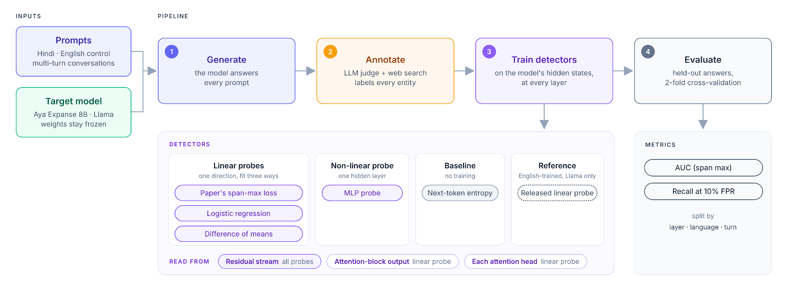

After we have access to our annotated dataset across the target models, we wanted to identify if we can correctly classify the model internals to detect hallucination while it happens so we passed the annotated data through our target LLMs and trained the following;

- Linear probe- which has been shown consistently to outperform several baselines as shown in Obesto Et. Al. It is a single linear layer on the residual stream (the output of each decoder layer), trained at every layer of the model.

- Non Linear probe- Newer research (Liang and Wang, 2025) suggests that non-linear probe is a promising direction (linear probes cannot capture non-linear structure in the model's hidden states, and lightweight MLP probes trained on frozen hidden states beat existing token-level hallucination detectors on LongFact, HealthBench and TriviaQA, including at low false-positive rates)

- Logistic regression trained on models internals (easier to train and lower latency, it has outperformed SOTA for some cases).

- MLP- the architecture of our non-linear probe: a 64-unit hidden layer with a GELU activation followed by one output, on the same residual-stream activations and trained with exactly the same loss and settings as the linear probe.

We also:

Difference of means- the direction from the mean activation of supported entity tokens to the mean activation of hallucinated ones, computed in closed form with no training ("The Geometry of Truth") finds that such probes generalize as well as other probing techniques and pick out directions that are more causally implicated in the model's outputs, which is why we also steer with this direction in Section 3.3.

For Llama we also report the probe released by Obeso et al. (2025), applied as is at layer 30.

We also used KL-divergence to make sure that our method does not degrade the performance too much and used the BCE and Span max loss functions defined as:

$$L_{\text{BCE}} = \frac{1}{|T|} \sum_{t \in T} w_t \left[ -y_t \log \sigma(z_t) - (1 - y_t) \log\left(1 - \sigma(z_t)\right) \right]$$

$$L_{\max} = \frac{1}{|S|} \sum_{s \in S} \left[ -y_s \log \sigma\left(\max_{t \in s} z_t\right) - (1 - y_s) \log\left(1 - \sigma\left(\max_{t \in s} z_t\right)\right) \right]$$

$$L = (1 - \omega) \cdot L_{\text{BCE}} + \omega \cdot L_{\max}, \quad \text{where } \omega = \min(1, k / K)$$

(More experiment details in the appendix)

For all our tasks and experiments, this methodology has been consistent to allow for uniformity and replication.

### 3.3 Steering and direction identification

We wanted to find out about the direction of hallucination using steering for Aya and Llama in a .We took the direction as the difference between the mean activation of hallucinated entity tokens (Not Supported and Insufficient Information) and supported ones, at every layer and picked the layer where it best separated hallucinated from supported entities(layer 14 for Llama with AUC 0.69 and layer 15 for Aya with AUC 0.73). We then used SafeTune's interpret module to find and remove the direction.We tested this on the existing answers, used KL divergence and used the strongest negative steering strength that kept the KL below 0.1 (-2 for both models).

We then had both of our direction removed models answer 20 new Hindi prompts and annotated all the answers with the same LLM judge.

**Finding the direction.** For each model we took the residual-stream activation at every entity token of the Hindi probing answers (the 57 Aya and 52 Llama answers from Section 3.2). At each layer l the direction is

$$r_l = \mu_{\text{hallucinated}} - \mu_{\text{supported}}$$

the mean activation over hallucinated entity tokens minus the mean over supported ones. We computed it separately on each of the two cross-validation folds and scored the held-out fold by projecting every entity onto it, taking the maximum over the entity's tokens (the same span-max rule as the probes), so the layer curve in Figure 6 is a held-out result. The direction carries signal from about layer 5 onward and peaks in the middle of the network: layer 15 for Aya (AUC 0.73) and layer 14 for Llama (AUC 0.69). Directions at neighbouring layers are close to each other (Figure C1, right), so the exact peak matters less than the band it sits in.

**SafeTune.** We ran the intervention through SafeTune (Lexsi Labs). SafeTune is built around contrast directions: its interpret module locates where a behaviour lives in the network from two contrasting sets of examples, and its steer module wraps the model in hooks that add or remove that direction at inference, while the weights stay untouched. The library is written for safety behaviours such as refusal; we used the same machinery with hallucinated and supported entities as the two contrast sets. That gave us, from one code path, the per-layer direction and its neuron-level breakdown, and reversible steering and ablation hooks for generation. Because the hooks never change the weights, the unmodified model is always one context manager away, which is what makes the before-and-after comparisons in Section 4.4 clean.

**Two interventions.** Steering adds a multiple of the direction to the residual stream:

$$h \leftarrow h + \alpha \cdot r$$

with α measured in units of the raw mean difference, so α = −1 moves an activation by exactly the gap between the average hallucinated and the average supported entity. Ablation removes the component along the unit direction r̂, so the model can no longer represent that difference at all, whichever way an activation points:

$$h \leftarrow h - (h \cdot \hat{r})\, \hat{r}$$

We swept α ∈ {−8, −4, −2, −1, +1, +2, +4, +8} and ablation over the existing Hindi answers, with the model reading each answer rather than writing a new one, and measured for every answer: the KL divergence of the next-token distribution from the unmodified model, averaged over tokens; the change in log-probability of hallucinated entity tokens, supported entity tokens and all other tokens; and the span-max AUC of the logistic-regression detector at the direction's layer (Figure 8, Figure C9).

**Choosing the strength.** KL grows quickly with \|α\|. For Aya the mean KL is 0.015 nats per token at α = −1, 0.062 at −2, 0.25 at −4 and 1.11 at −8; for Llama it is 0.007, 0.031, 0.19 and 2.95. With a budget of 0.1, α = −2 is the strongest negative setting that both models stay under. Ablation is gentler than any steering setting beyond ±1: 0.019 nats per token for Aya and 0.023 for Llama. At α = −2 the log-probability of hallucinated entity tokens drops more than that of supported ones (Aya −0.21 against −0.16; Llama −0.18 against −0.05), which is the effect we want: the model becomes less sure of the entities it tends to get wrong, and only slightly less sure of the rest.

**Neurons and heads.** To see where the direction is written, we used SafeTune's neuron identification on the MLP output projections (mlp.down_proj): at every layer we ranked neurons by the absolute cosine between their output weight column and the direction, and kept the top 16 (Figure C10). We also scored all 1,024 attention heads of each model by how well their write along the direction separates hallucinated from supported entities (Figure 10) and by where they attend (the question, the answer so far, the first token), and correlated the strongest heads with the judge label (Figure C1, left).

**Generation test.** Finally, both models answered 20 new Hindi prompts, not used to find the direction, under three conditions: unmodified, with the direction ablated, and steered at α = −2. The answers were labelled by the same gpt-oss-120b judge with Exa and DuckDuckGo search and the Hindi note, and we compare the 19 (Aya) and 18 (Llama) prompts that were annotated in all three conditions. Besides the hallucination rate we tracked the measures that would show a broken model: entities per answer (does it stop committing to facts?), answer length, the share of Devanagari characters (does it drift out of Hindi?) and the share of answers that refuse or abstain. The 95% intervals are bootstrap intervals.

### 3.4 Metrics and why we chose them

We report more than one metric for detection and for the intervention, because each one alone can be gamed or can hide a failure.

- **Span-max AUC (main detection metric).** The score of an entity is the highest probe score over its tokens, and the AUC is taken over entities. It is the headline metric of Obeso et al. (2025), so our numbers are comparable with theirs; it does not depend on a threshold, which matters because the share of hallucinated entities differs between our runs (32% to 44%); and it works at the level of entities, which is what a reader checks.

- **Recall at 10% false-positive rate.** If the detector may wrongly flag one in ten correct entities, what share of hallucinated ones does it catch? AUC can look fine while the detector is useless at low false-alarm rates; this is the operating point that matters for a highlighter people will actually leave switched on.

- **Best-threshold accuracy and entity-token AUC.** Accuracy at the accuracy-optimal threshold is what the live demo uses as its default flag threshold. Token-level AUC over all entity tokens checks that the signal is not carried by a single token per span.

- **Hallucination rate per entity.** The share of entities the judge labels Not Supported or Insufficient Information, with Not Supported alone reported next to it. We count per entity rather than per answer because entity density differs about threefold between languages (21.4 entities per English answer against 6.35 for Hindi Llama), so a per-answer rate would make sparse Hindi answers look more reliable than they are.

- **Guardrail measures for the intervention.** Entities per answer, answer length, share of Devanagari characters and share of answers that refuse or abstain. A model can lower its hallucination rate trivially by saying less, switching language or refusing; these catch that.

- **KL divergence from the unmodified model (nats per token).** How far an intervention moves the model's next-token distribution on text it already wrote. We use it to choose the steering strength, with a budget of 0.1.

- **Next-token entropy as the “before” detector.** It needs no training and is available from any model that exposes logits, so the gap between it and a trained detector is what the hidden states add.

### 3.5 Why these datasets, tasks and models

**Task.** We detect hallucinations at the level of entities in long-form answers. Long answers mix correct and fabricated facts, so a single label per answer is too coarse, and the specific names, dates and numbers are what a user copies, cites or acts on. A token-level probe can flag them while the answer streams, which a per-answer checker cannot.

**Datasets.** LongFact and LongFact++ prompts explicitly ask for specific details (names, numbers, events, places, dates), which produces many checkable entities per answer, and they are the prompts behind the reference probe, so our English numbers can be compared with the paper. We chose Hindi because it is widely used and multilingual benchmarks find hallucination detection weakest there (Section 2), and multi-turn conversations because that is how people actually use chat models and models rarely recover from early mistakes (Laban et al., 2025).

**Models.** The probes and the steering read hidden states, so the models must have open weights; a closed API does not expose them. 8B models fit the free Kaggle T4 ×2 notebooks we trained on and a single 24 GB GPU for serving. Llama 3.1 8B is the model the reference probe was trained on, and Aya Expanse 8B is trained on 23 languages including Hindi, so the pair lets us compare an English-centric model with a multilingual one in the same setup (Section 3.1).

### 3.6 Lexsi Labs libraries in the pipeline

Three Lexsi Labs libraries sit at different stages of the pipeline. Table 2 lists what each one does here and what it produces.

*Table 2. Lexsi Labs libraries used in this project.*

| **Stage**         | **Library**                   | **What it does in this project**                                                                                                                                                                                                  | **Output**                                                              |
|-------------------|-------------------------------|-----------------------------------------------------------------------------------------------------------------------------------------------------------------------------------------------------------------------------------|-------------------------------------------------------------------------|
| **Data**          | CuratorKit                    | Cleaning and deduplication of translated prompts, generated answers and judge annotations; provenance files (manifest, rejected rows with reasons, dataset card, checksums); exports in chat and preference formats.              | The Hindi, multi-turn and control datasets on the Hub                   |
| **Interpret**     | SafeTune (safetune.interpret) | Contrast direction between hallucinated and supported entity tokens at every layer; ranking of mlp.down_proj neurons by cosine with the direction.                                                                                | Hallucination directions (Aya L15, Llama L14); top-16 neurons per layer |
| **Steer**         | SafeTune (safetune.steer)     | Reversible hooks that add α·r to the residual stream or project the direction out; the weights are never modified.                                                                                                                | Steered and ablated answers; the KL sweep                               |
| **Post-training** | AlignTune                     | Reads CuratorKit's preference and chat exports directly (DPO, GRPO, SFT), so the entity labels and probe scores can become a training signal; its Indic evaluation suite (MILU, IndicXTREME, IndicGenBench) checks Hindi ability. | Route for making the fix permanent (Section 5)                          |

Using the libraries rather than one-off scripts gave us three practical things. The datasets carry their own provenance, so every comparison in Section 4 can be traced to the exact prompts and judge. The intervention is a hook, not a new set of weights, so the base model and the modified model are compared on the same forward pass and the change can be switched off at any time. And the data formats already line up with a post-training library, so the step from detecting hallucinations to training them out does not need new plumbing.

### 3.7 Deployment: live demo

The demo (demo/app.py in the repository, a Gradio app) loads one 8B model in fp16 with Hugging Face transformers. The model answers in Hindi or English; at every new token a linear probe reads the hidden state at its layer and gives a hallucination score between 0 and 1, and the answer is shaded by that score as it streams in. Follow-up questions keep the conversation, so the multi-turn probes can be tried directly. For Aya it offers our Hindi probe (layer 20) and multi-turn probe (layer 16); for Llama, the paper's released probe (layer 30) and our multi-turn (layer 9) and Hindi (layer 13) probes. Default thresholds are the accuracy-optimal span-max thresholds from our results, and a slider changes them live. It runs on Kaggle (T4 ×2) or as a Hugging Face Space on ZeroGPU or any GPU with at least 24 GB. Detection costs one dot product with a hidden state the model has already computed, so it adds no noticeable latency.

## 4. Results

### 4.1 How much the models hallucinate in Hindi

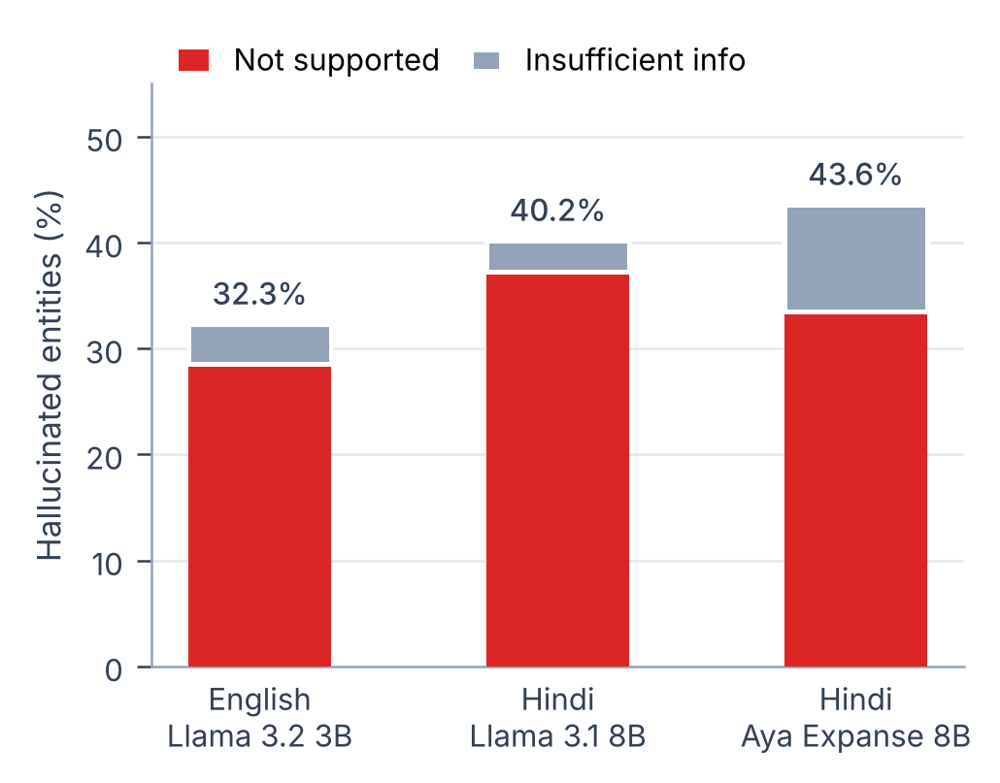

*Figure 1. Share of entities the web-search judge labelled Not Supported (red) or Insufficient Information (grey), on the same 60 LongFact prompts per run.*

On the same prompts, a larger share of entities in Hindi answers was judged hallucinated than in English: 40.2% for Llama 3.1 8B and 43.6% for Aya Expanse 8B, against 32.3% for the English control. Hindi answers were also much less specific. They contained 6.35 (Llama) and 9.95 (Aya) checkable entities per answer, against 21.4 in English, and 13.3% of Llama’s Hindi answers contained no entities at all (Table A1). Measured per answer instead of per entity, Hindi Llama would therefore look more reliable than it is (Appendix A.1).

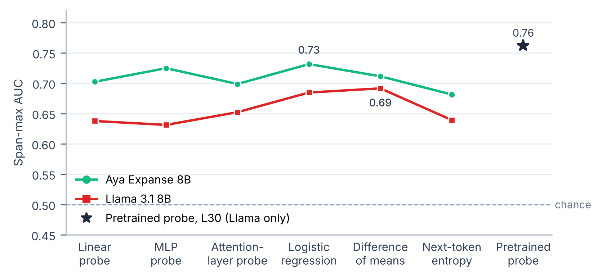

*Figure 2. Best held-out span-max AUC of each detector in the two Hindi runs (each detector at its best layer). The star is the probe released by Obeso et al. (2025), Llama only.*

Aya and Llama hallucinated at similar rates in Hindi. Counting Not Supported and Insufficient Information together, Aya was slightly higher (43.6% vs 40.2%); counting Not Supported alone, it was slightly lower (33.5% vs 37.3%). The clearer difference is how much each model commits to: Aya produced 57% more entities per answer than Llama (9.95 vs 6.35). As the next section shows, Aya’s hallucinations are also easier to detect from its internal states.

### 4.2 Detecting hallucinations in Hindi

Every trained detector does better on Aya than on Llama (Figure 2). On Aya the best are logistic regression (0.732, layer 14) and the MLP probe (0.725, layer 15), against 0.681 for next-token entropy; the MLP probe also has the highest recall at 10% FPR, 0.40 against 0.20 for entropy. On Llama our detectors stay between 0.631 and 0.691, close to entropy (0.639), and the English-trained probe released with the paper does best (0.762 at layer 30). With 52 to 57 Hindi answers per run, the simpler detectors (logistic regression, difference of means) do as well as or better than the probes trained with the paper's loss, which is what we would expect with this little data (Section 5). Full numbers are in Tables A2 and A3 and the layer curves in Figure C3.

### 4.3 Multi-turn conversations

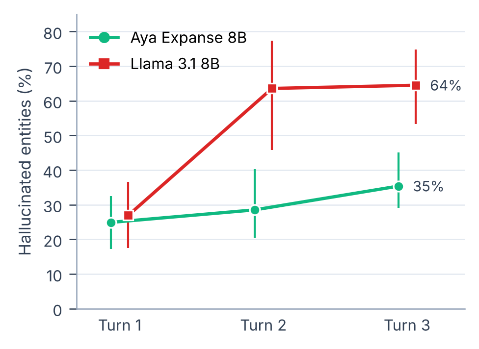

*Figure 3. Share of entities judged hallucinated (Not Supported + Insufficient Information) at each turn of the three-turn conversations. Bars are 95% bootstrap intervals over answers (Table A8).*

Llama's answers get much less reliable after the first follow-up question: hallucinated entities go from 26.9% at turn 1 to 63.6% at turn 2 and 64.5% at turn 3, and the intervals for turn 1 and turn 3 do not overlap. Aya rises more slowly, from 24.9% to 28.5% and 35.4%. Both models start at about the same level, so the gap comes from how they handle follow-up questions rather than from what they know at turn 1. The example in the introduction shows how errors carry forward: Llama repeats fabricated figures from turn 2 in turn 3 and adds a new one.

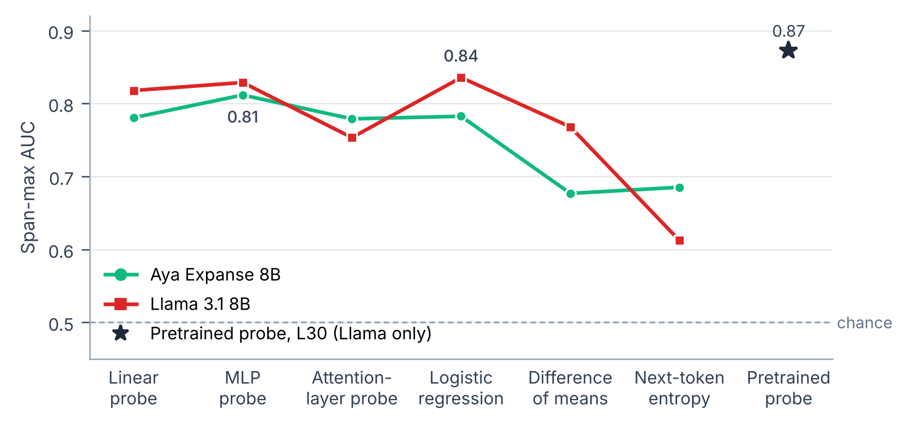

*Figure 4. Best held-out span-max AUC of each detector on the multi-turn conversations (all turns pooled). The star is the pretrained probe, Llama only.*

Detection is easier in the multi-turn runs than in Hindi (Figure 4). The best detectors reach 0.836 on Llama (logistic regression, layer 13) and 0.812 on Aya (MLP probe, layer 18), and the linear and MLP probes are above 0.78 on both models. Next-token entropy is far behind (0.612 Llama, 0.685 Aya), and the released English probe reaches 0.873 on Llama. These probes were trained on our conversations plus 150 of the paper's English answers per source, so they are not directly comparable with the Hindi numbers (Appendix, experimental details).

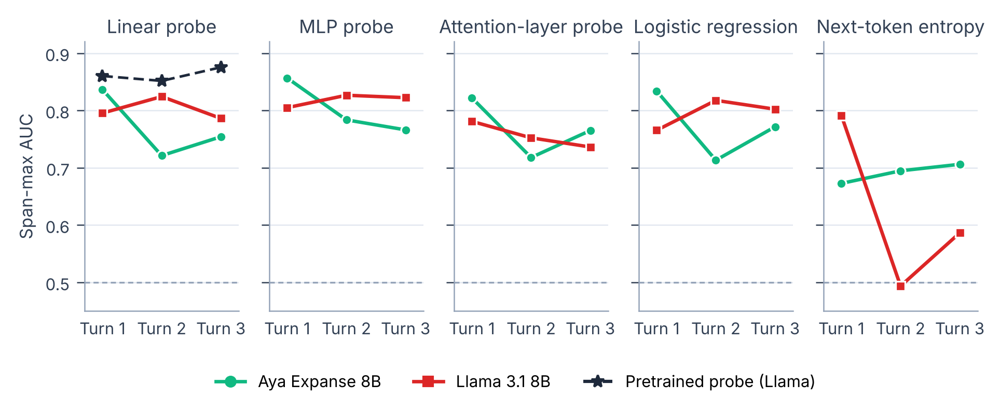

*Figure 5. Span-max AUC at each turn, with each detector fixed at its best layer over all turns. The dashed line with stars is the pretrained probe (Llama only).*

Across turns (Figure 5, Table A7), the probes on Llama hold steady (MLP 0.805, 0.827, 0.822) while next-token entropy collapses after turn 1 (0.791, 0.494, 0.586). One reading is that once the model fabricates with confidence it is no longer uncertain at the token level, but its hidden states still show it. On Aya the probes are best at turn 1 (MLP 0.857) and lower at turns 2 and 3 (0.784, 0.766). With 19 to 22 answers per turn the per-turn differences are small samples, but the entropy collapse on Llama is large.

### 4.4 Steering with SafeTune: removing the hallucination direction

The hallucination direction is a weak but real signal on its own (Figure 6). It peaks in the middle layers, where the trained detectors in Section 4.2 also do best, and on held-out entities the hallucinated ones sit clearly to the right of the supported ones for Aya (Figure 7; AUC 0.73 at layer 15 over 597 entities) and less clearly for Llama (0.69 at layer 14 over 381 entities).

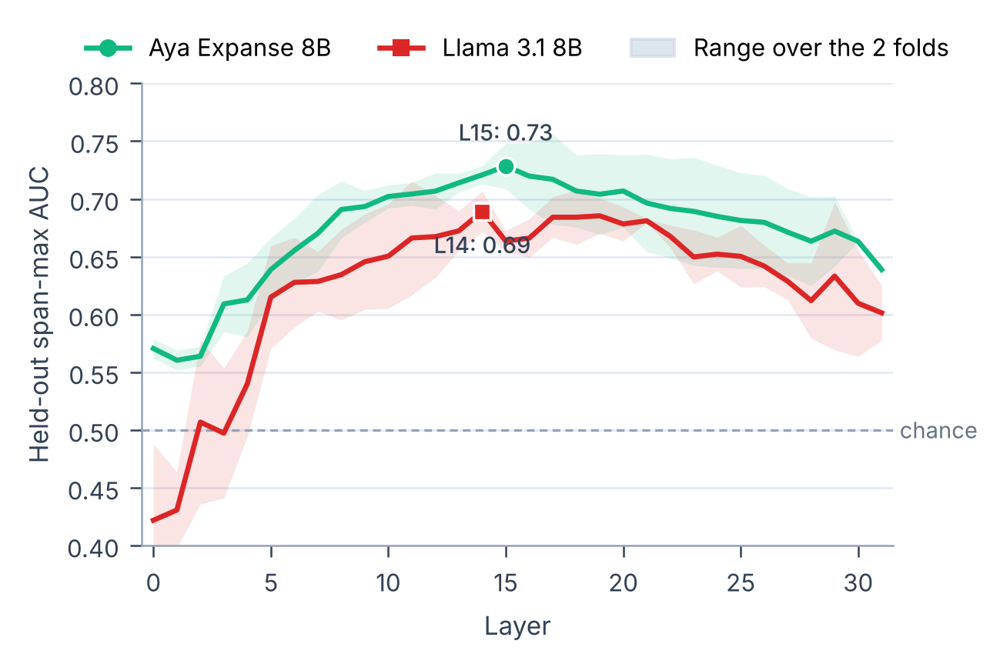

*Figure 6. Held-out span-max AUC of the hallucination direction (difference of means) at each layer. The shaded band is the range over the two folds; the marker is the layer used for steering.*

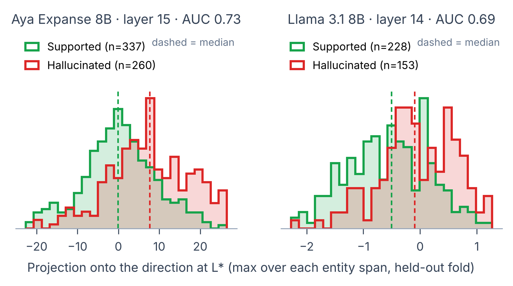

*Figure 7. Held-out projection of each entity onto the direction at the steering layer (maximum over the entity's tokens), for supported (green) and hallucinated (red) entities. Dashed lines are medians.*

Figure 8 shows what steering does to the detector. Pushing activations either way along the direction lowers the detector's AUC, and removing the direction drops it below chance (0.47 for Aya, 0.39 for Llama). Once SafeTune's hook takes the direction out, what is left of the activations at that layer no longer separates hallucinated from supported entities, so the detector's signal at that layer is concentrated in this one direction.

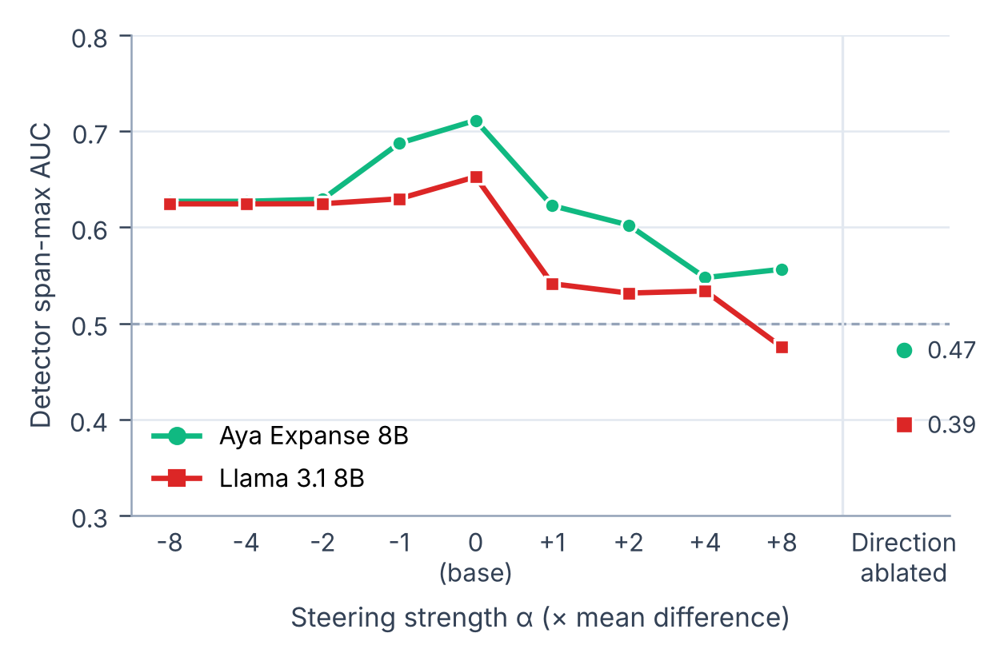

*Figure 8. Span-max AUC of the logistic-regression detector at the direction's layer while steering with strength α (in units of the mean difference), and with the direction ablated (right). Values in Table A9.*

The real test is whether new answers get better (Figure 9, Table 3). For Aya, removing the direction lowered the share of hallucinated entities in answers to new Hindi prompts from 61.9% to 47.8%, a drop of 14.2 points (95% CI −22.7 to −3.9), or 23% in relative terms. Not Supported entities alone fell from 50.8% to 40.4%. The answers kept their shape: 9.4 entities per answer against 10.4, 2,934 characters against 2,994, 96.3% Devanagari against 96.5%, and no answer refused or abstained. Steering at α = −2 moved in the same direction (−10.7 points) but its interval includes zero. For Llama, neither intervention helped: with the direction removed the rate was 65.9% (+2.1 points), and the answers became shorter (1,723 against 2,762 characters) with fewer entities (7.3 against 10.9), exactly the kind of side effect the guardrail measures are there to catch. The direction worked on Aya, where it was also the better detector (0.73 against 0.69). Base rates here are higher than in Figure 1 because these are a different set of prompts, generated through Hugging Face transformers rather than the Ollama q8_0 builds.

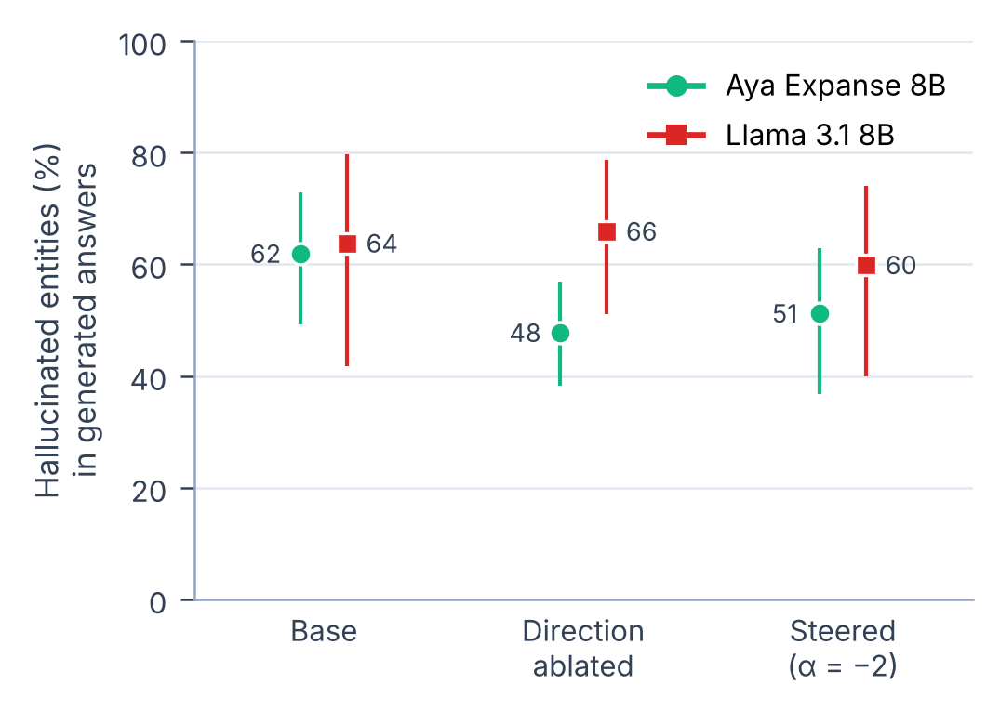

*Figure 9. Hallucinated entities (Not Supported + Insufficient Information) in answers to new Hindi prompts, for the unmodified model, the model with the direction ablated, and the model steered at α = −2. Bars are 95% bootstrap intervals (Table A10).*

*Table 3. Before and after removing the hallucination direction with SafeTune (new Hindi prompts; 19 for Aya, 18 for Llama). KL and detector AUC are measured on the existing Hindi answers.*

| **Metric**                                         | **Aya before** | **Aya after**         | **Llama before** | **Llama after**       |
|----------------------------------------------------|----------------|-----------------------|------------------|-----------------------|
| **Hallucinated entities, NS + II (%)**             | 61.9           | 47.8                  | 63.8             | 65.9                  |
| **Change vs before (points, 95% CI)**              | –              | −14.2 (−22.7 to −3.9) | –                | +2.1 (−18.0 to +26.4) |
| **Not Supported only (%)**                         | 50.8           | 40.4                  | 60.2             | 54.5                  |
| **Entities per answer**                            | 10.4           | 9.4                   | 10.9             | 7.3                   |
| **Characters per answer**                          | 2,994          | 2,934                 | 2,762            | 1,723                 |
| **Devanagari characters (%)**                      | 96.5           | 96.3                  | 99.2             | 97.5                  |
| **Answers that refuse or abstain (%)**             | 0              | 0                     | 0                | 0                     |
| **KL from unmodified model (nats/token)**          | 0              | 0.019                 | 0                | 0.023                 |
| **Detector span-max AUC at the direction's layer** | 0.711          | 0.472                 | 0.653            | 0.395                 |

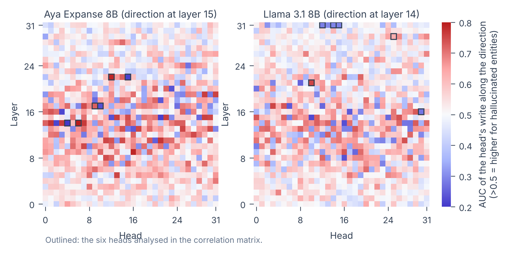

*Figure 10. For every attention head, the AUC of its write along the hallucination direction (above 0.5: it writes more along the direction for hallucinated entities). Outlined: the six heads analysed in Figures C1 and C8.*

Figure 10 shows which attention heads write along the direction. In Aya the signal is spread over many heads in roughly layers 8 to 20 rather than concentrated in a few; the strongest single heads (L14H6 and L22H12, both with an AUC of about 0.8) are among the six analysed in Figures C1 and C8. In Llama the pattern is weaker and more scattered, which fits the weaker direction.

### 4.5 What this changes for a user

A Hindi user of Aya Expanse 8B with this setup gets two things the base model does not give them. The first is fewer fabricated entities: with the direction removed, the share of unsupported names, dates and numbers drops by 14 points (a 23% relative reduction) with no loss in length, language or willingness to answer. The second is a warning on the ones that remain: the probe shades each entity as it streams, at the cost of one dot product per token, and at a 10% false-alarm rate it catches about 40% of the hallucinated entities in Hindi (Aya, MLP probe) and between 42% and 59% in multi-turn conversations. Neither needs a second model, a web search or repeated sampling at inference, which is what makes the approach usable in real time, unlike the judge pipeline we used to build the labels. For Llama the detector is the useful part, especially in long conversations where its own uncertainty stops being a warning sign (Section 4.3), and the direction should not be removed.

### 4.6 Cost: self-hosted small model against a closed-source API

Our intervention does not change the weights, so the comparison is between serving Aya Expanse 8B with the probe and the SafeTune hook ourselves and paying per token for a closed model. The probe and the hook add one dot product and one vector operation per token, so we count them as free. A closed API cannot run our probe at all, because it does not expose hidden states; flagging entities there would need a judge call with web search for every answer. We leave that out of the closed-source side, so the comparison below favours the API.

*Table 4. Monthly cost for a realistic volume (estimate; assumptions in the rows).*

**Volume:** 10,000 Hindi long-form answers per month at our 2,048-token generation cap = 20.48M output tokens (input tokens left out on both sides)

|                               | **GPT-5 (API)**                                                                                                                         | **GPT-5.5 (API)**         | **Aya 8B on 1× L4, one request at a time**                                                         | **Aya 8B on 1× L4, batched**                             |
|-------------------------------|-----------------------------------------------------------------------------------------------------------------------------------------|---------------------------|----------------------------------------------------------------------------------------------------|----------------------------------------------------------|
| **Price**                     | \$10 per 1M output tokens                                                                                                               | \$30 per 1M output tokens | \$0.80 per GPU-hour                                                                                | \$0.80 per GPU-hour                                      |
| **Throughput**                | –                                                                                                                                       | –                         | 15 tokens/s (fp16 decoding is capped near 19 tokens/s by the L4's 300 GB/s over ~16 GB of weights) | 300 tokens/s (assumed for batched serving, not measured) |
| **GPU hours**                 | –                                                                                                                                       | –                         | 379.3                                                                                              | 19.0                                                     |
| **Cost per month**            | \$204.80                                                                                                                                | \$614.40                  | \$303.41                                                                                           | \$15.17                                                  |
| **Cost per 1M output tokens** | \$10.00                                                                                                                                 | \$30.00                   | \$14.81                                                                                            | \$0.74                                                   |
| **Can run the probe**         | No                                                                                                                                      | No                        | Yes                                                                                                | Yes                                                      |

Served one request at a time, as the demo runs, the L4 is more expensive than GPT-5, so self-hosting only pays off when requests are batched. At the batched estimate it is about 13 times cheaper than GPT-5 and 40 times cheaper than GPT-5.5 for the same volume, and the detector comes with it. All of our own experiments ran on Kaggle's free T4 ×2 notebooks. Prices are list prices (OpenAI API pricing and Hugging Face Inference Endpoints, November 2026), and the batched throughput is an estimate that should be measured on the deployed Space before relying on the ratio.

## 5. Limitations and Future Work
The biggest limitation of this study is its scale; This was a very small pilot study. Since compute was limited and we had to make use of kaggle notebooks, we were only able to compare across 8B models, even there the number of samples that we used were quite small as compared to other studies (about ¼ of the data or less) and as a result, a lot of the data that you see related to probing might not generalize with more training data, supporting evidence for this is the fact that logistic regression, a simpler method works better for some hindi cases

Another limitation that this study had was using translator instead of the actual hindi statements, partly owing to the lack of time and partly because translating documents was the only way to make sure that our data fit in the pipeline that we created which was necessary for uniformity

The hallucination numbers that we measured, only a small fraction of those were on the same prompts. For multi-turn dataset, we needed to include more turns with varying degree of hallucinations, also llm as a judge for hindi dataset is also a general purpose one, while we did validate it's output with human labels but having access to a specialized indic language model would make the quality of the annotation better. Also, the annotations verification here will not scale well because of human labour involved

Future work here would include an experimental setup where we would ideally: build a proper dataset first, include various model families and ideally compare across the same prompts for different models and different scales. COT and agentic workflow hallucination also are a natural follow up here.Another interesting direction we are keen to explore is translating this study to more low resource languages such as odia, assamese, gujarati etc

**Next step with AlignTune.** Steering is an inference-time fix. The natural next step is to make it permanent with AlignTune: the CuratorKit exports of our annotated answers can be turned into preference pairs (the answer with fewer unsupported entities preferred) for DPO, or the probe score can serve as a reward for GRPO, and AlignTune's Indic evaluation suite (MILU, IndicXTREME, IndicGenBench) would check that Hindi ability survives. SafeTune's evaluation module would then confirm that the tuned model has not drifted on safety.

Lastly, despite the scale and the limitations we still think that this project can have impact and inspire people to fact check before forming an opinion

## 6. Conclusion
Overall, we found more prevalence of hallucination in hindi language and we also found that finding the hallucination direction and removing the same improves the non hallucinated content drastically, we also found that the text generated in hindi had fewer entities and that for multi-turn conversation, the hallucinated content increased with the increase in turns. For content that mimics real life conversations, linear probing to detect and remove hallucination is a better idea than all the other methods and we also found that specialized llms do help reduce hallucinations for non english languages

## Code and Data
- **Code repository**: https://github.com/shreshtha48/Hallucination-detection

- **Live demo (Hugging Face Space)**: **\[add the Space URL before submitting\]** (code: demo/app.py, demo/E_live_demo.ipynb)

- **Hugging Face article**: **\[add the article URL before submitting\]**

- Data/Datasets:

  - **Hindi prompts** (LongFact / LongFact++ translated with Sarvam‑Translate):

    - [https://huggingface.co/datasets/shreshthamodi02/longfact-hindi](https://huggingface.co/datasets/shreshthamodi02/longfact-hindi) (all translations)

    - [https://huggingface.co/datasets/shreshthamodi02/longfact-hindi-paper](https://huggingface.co/datasets/shreshthamodi02/longfact-hindi-paper) (the paper’s test split, Hindi + original English prompt)

  - **Hindi answers** (generated):

    - [https://huggingface.co/datasets/shreshthamodi02/longfact-hi-llama3.1-8b-instruct-q8-0](https://huggingface.co/datasets/shreshthamodi02/longfact-hi-llama3.1-8b-instruct-q8-0)

    - [https://huggingface.co/datasets/shreshthamodi02/longfact-hi-aya-expanse-8b-q8-0](https://huggingface.co/datasets/shreshthamodi02/longfact-hi-aya-expanse-8b-q8-0)

  - **Hindi answers** (annotated by the web‑search judge):

    - [https://huggingface.co/datasets/shreshtha2002/longfact-hi-llama3.1-8b-instruct-q8-0-annotated](https://huggingface.co/datasets/shreshtha2002/longfact-hi-llama3.1-8b-instruct-q8-0-annotated)

    - [https://huggingface.co/datasets/shreshtha2002/longfact-hi-aya-expanse-8b-q8-0-annotated](https://huggingface.co/datasets/shreshtha2002/longfact-hi-aya-expanse-8b-q8-0-annotated)

  - **Multi‑turn conversations** (3 turns, generated):

    - [https://huggingface.co/datasets/shreshthamodi02/longfact-multiturn-llama3.1-8b-instruct-q8-0](https://huggingface.co/datasets/shreshthamodi02/longfact-multiturn-llama3.1-8b-instruct-q8-0)

    - [https://huggingface.co/datasets/shreshthamodi02/longfact-multiturn-aya-expanse-8b-q8-0](https://huggingface.co/datasets/shreshthamodi02/longfact-multiturn-aya-expanse-8b-q8-0)

  - **Multi‑turn conversations** (annotated):

    - [https://huggingface.co/datasets/shreshtha2002/longfact-multiturn-llama3.1-8b-instruct-q8-0-annotated](https://huggingface.co/datasets/shreshtha2002/longfact-multiturn-llama3.1-8b-instruct-q8-0-annotated)

    - [https://huggingface.co/datasets/shreshtha2002/longfact-multiturn-aya-expanse-8b-q8-0-annotated](https://huggingface.co/datasets/shreshtha2002/longfact-multiturn-aya-expanse-8b-q8-0-annotated)

  - **English control** (Llama 3.2 3B, same prompts as Hindi):

    - [https://huggingface.co/datasets/shreshtha2002/longfact-en-llama3.2-3b-instruct-q8-0](https://huggingface.co/datasets/shreshtha2002/longfact-en-llama3.2-3b-instruct-q8-0)

    - [https://huggingface.co/datasets/shreshtha2002/longfact-en-llama3.2-3b-instruct-q8-0-annotated](https://huggingface.co/datasets/shreshtha2002/longfact-en-llama3.2-3b-instruct-q8-0-annotated)

  - **Original paper data used:**

    - [https://huggingface.co/datasets/obalcells/longfact-annotations](https://huggingface.co/datasets/obalcells/longfact-annotations)

    - [https://huggingface.co/datasets/obalcells/longfact-augmented-annotations](https://huggingface.co/datasets/obalcells/longfact-augmented-annotations)

    - [https://huggingface.co/datasets/obalcells/longfact-augmented-prompts](https://huggingface.co/datasets/obalcells/longfact-augmented-prompts)

- Trained probes, results and steering outputs: [https://huggingface.co/shreshtha2002/hallucination-probes-multiturn](https://huggingface.co/shreshtha2002/hallucination-probes-multiturn). Each folder holds the fold checkpoints, metrics CSVs and figures for one run:

  - hindi-llama/

  - hindi-aya/

  - multiturn-llama/

  - multiturn-aya/

  - control-en-llama3.2-3b-instruct-q8-0/

  - steer-hindi/ (also holds the hallucination directions, neuron and head analysis, steered answers and their judge labels)

- Models used:

  - **Target models:**

    - Llama 3.1 8B Instruct: [https://huggingface.co/meta-llama/Llama-3.1-8B-Instruct](https://huggingface.co/meta-llama/Llama-3.1-8B-Instruct) (answers generated with Ollama llama3.1:8b-instruct-q8_0)

    - Aya Expanse 8B: [https://huggingface.co/CohereLabs/aya-expanse-8b](https://huggingface.co/CohereLabs/aya-expanse-8b) (Ollama aya-expanse:8b-q8_0)

  - **English control:** Llama 3.2 3B Instruct: [https://huggingface.co/meta-llama/Llama-3.2-3B-Instruct](https://huggingface.co/meta-llama/Llama-3.2-3B-Instruct) (Ollama llama3.2:3b-instruct-q8_0)

  - **Translator:** Sarvam‑Translate: [https://huggingface.co/sarvamai/sarvam-translate](https://huggingface.co/sarvamai/sarvam-translate)

  - **Follow‑up question writer** (multi‑turn): Aya Expanse 8B through Ollama (aya-expanse:8b)

  - **Judge:** gpt‑oss‑120b through Hugging Face Inference Providers (Groq): [https://huggingface.co/openai/gpt-oss-120b](https://huggingface.co/openai/gpt-oss-120b)

  - **Reference probe:** the original paper’s released probe: [https://huggingface.co/obalcells/hallucination-probes](https://huggingface.co/obalcells/hallucination-probes)

- Other artifacts:

  - **Original paper code:** [https://github.com/obalcells/hallucination_probes](https://github.com/obalcells/hallucination_probes)

  - **SafeTune** (Lexsi Labs), used for steering: [https://github.com/Lexsi-Labs/SafeTune](https://github.com/Lexsi-Labs/SafeTune)

  - **CuratorKit** (Lexsi Labs), used for dataset curation: [https://pypi.org/project/curatorkit/](https://pypi.org/project/curatorkit/)

  - **AlignTune** (Lexsi Labs), post-training route for the labels: [https://github.com/Lexsi-Labs/aligntune](https://github.com/Lexsi-Labs/aligntune)

  - **Web search for the judge:** Exa MCP ([https://mcp.exa.ai/mcp](https://mcp.exa.ai/mcp)) with DuckDuckGo as fallback

**References**

- Abdaljalil et al. (2026). Halluverse-M³: A multitask multilingual benchmark for hallucination in LLMs. arXiv:2602.06920.

- Alansari et al. (2026). CrossHallu: Do Hallucination Signals Generalize Across Languages and Domains in Large Language Model’s Internals? arXiv:2607.04029.

- Azaria and Mitchell (2023). The Internal State of an LLM Knows When It’s Lying. Findings of EMNLP 2023.

- Chen et al. (2024). DiaHalu: A Dialogue-level Hallucination Evaluation Benchmark for Large Language Models. arXiv:2403.00896.

- Fan et al. (2026). HalluHard: A Hard Multi-Turn Hallucination Benchmark. arXiv:2602.01031.

- Farquhar et al. (2024). Detecting hallucinations in large language models using semantic entropy. Nature.

- Han et al. (2025). Simple Factuality Probes Detect Hallucinations in Long-Form Natural Language Generation. Findings of EMNLP 2025.

- He et al. (2025). Modeling and Predicting Multi-Turn Answer Instability in Large Language Models. NeurIPS 2025 Workshop on Multi-Turn Interactions in LLMs. arXiv:2511.10688.

- Jara-Mikolajczak et al. (2026). LLM Robustness under Extended Contexts: Hallucination and Detection in Sequential Question Answering. CORIA-TALN 2026.

- Kadavath et al. (2022). Language Models (Mostly) Know What They Know. arXiv.

- Kossen et al. (2024). Semantic Entropy Probes: Robust and Cheap Hallucination Detection in LLMs. arXiv:2406.15927.

- Laban et al. (2025). LLMs Get Lost In Multi-Turn Conversation. arXiv:2505.06120.

- Liang and Wang (2025). Neural Probe-Based Hallucination Detection for Large Language Models. arXiv:2512.20949.

- Manakul et al. (2023). SelfCheckGPT: Zero-Resource Black-Box Hallucination Detection for Generative Large Language Models. EMNLP 2023.

- Min et al. (2023). FActScore: Fine-grained Atomic Evaluation of Factual Precision in Long Form Text Generation. EMNLP 2023.

- Obeso et al. (2025). Real-Time Detection of Hallucinated Entities in Long-Form Generation. arXiv:2509.03531.

- Orgad et al. (2024). LLMs Know More Than They Show: On the Intrinsic Representation of LLM Hallucinations. arXiv:2410.02707.

- Simhi et al. (2026). Old Habits Die Hard: How Conversational History Geometrically Traps LLMs. arXiv:2603.03308.

- Singh (2026). Does the Truthfulness Signal Survive Code-Mixing? Probing Hidden States for Hallucination Detection in Hinglish. arXiv:2609.22138.

- Terdalkar et al. (2025). BHRAM-IL: A Benchmark for Hallucination Recognition and Assessment in Multiple Indian Languages. arXiv:2512.01852.

- Vázquez et al. (2025). SemEval-2025 Task 3: Mu-SHROOM, the Multilingual Shared Task on Hallucinations and Related Observable Overgeneration Mistakes. arXiv:2504.11975.

- Wei et al. (2024). Long-form factuality in large language models. arXiv (LongFact and SAFE).

- Hugging Face (2026). Inference Endpoints pricing (NVIDIA L4, \$0.80 per hour). [https://huggingface.co/docs/inference-endpoints/support/pricing](https://huggingface.co/docs/inference-endpoints/support/pricing)

- OpenAI (2026). API pricing (GPT-5: \$10 per 1M output tokens; GPT-5.5: \$30 per 1M output tokens). [https://openai.com/api/pricing/](https://openai.com/api/pricing/)

## Appendix (optional)
Example of hindi language hallucination detection

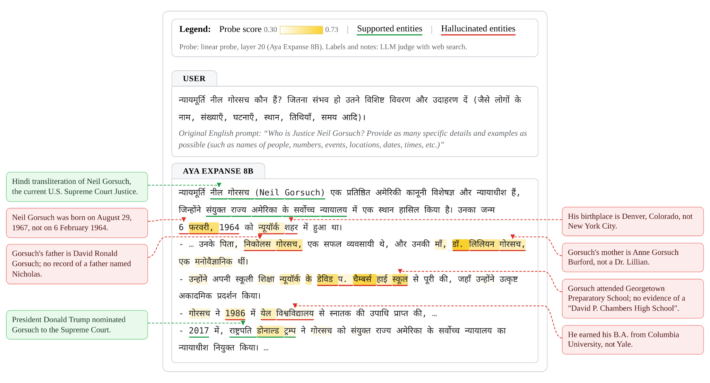

Experimental details:

| **Setting**     | **Hindi**                                               | **Multi-turn**                      |
|-----------------|---------------------------------------------------------|-------------------------------------|
| Model           | frozen, fp16, all 32 layers                             | same                                |
| Labels          | Not Supported / Insufficient Info = 1, Supported = 0    | same                                |
| Token weights   | entity tokens 10, other answer tokens 1, prompt ignored | same                                |
| Max length      | 2,560 tokens                                            | 2,048 tokens                        |
| Training data   | our answers only                                        | ours + 150 paper answers per source |
| Evaluation      | 2-fold cross-validation by prompt                       | 2-fold by conversation              |
| Optimizer       | AdamW, lr 5e-4, batch 8                                 | same                                |
| Epochs          | 10                                                      | 2                                   |
| MLP hidden size | 64                                                      | 64                                  |
| Seed            | 42                                                      | 42                                  |

*Table A1. Hallucination rates and best-layer detector AUCs, English control vs Hindi runs.*

| **Run**                    | **Answers** | **Entities** | **Entities / answer** | **NS (%)** | **NS + II (%)** | **Answers with ≥ 1 NS (%)** | **Answers with 0 entities (%)** | **Best detector (span-max AUC)**                                |
|----------------------------|-------------|--------------|-----------------------|------------|-----------------|-----------------------------|---------------------------------|-----------------------------------------------------------------|
| **English · Llama 3.2 3B** | 60          | 1,286        | 21.4                  | 28.5       | 32.3            | 76.7                        | 1.7                             | Logistic regression, L11 (0.781)                                |
| **Hindi · Llama 3.1 8B**   | 60          | 381          | 6.35                  | 37.3       | 40.2            | 48.3                        | 13.3                            | Difference of means, L14 (0.691); pretrained probe, L30 (0.762) |
| **Hindi · Aya Expanse 8B** | 60          | 597          | 9.95                  | 33.5       | 43.6            | 71.7                        | 5.0                             | Logistic regression, L14 (0.732)                                |

**Table A2. Hindi · Aya Expanse 8B** (n = 57 answers)

| **Detector**          | **Best layer** | **Span-max AUC** | **Recall at 10% FPR** | **Best-threshold accuracy** | **Entity-token AUC** |
|-----------------------|----------------|------------------|-----------------------|-----------------------------|----------------------|
| Linear probe          | 20             | 0.702            | 0.31                  | 0.67                        | 0.591                |
| MLP probe             | 15             | 0.725            | 0.40                  | 0.69                        | 0.626                |
| Attention-layer probe | 18             | 0.699            | 0.35                  | 0.66                        | 0.598                |
| Logistic regression   | 14             | **0.732**        | 0.33                  | 0.68                        | 0.714                |
| Difference of means   | 15             | 0.711            | 0.00                  | 0.68                        | 0.683                |
| Next-token entropy    | –              | 0.681            | 0.20                  | 0.66                        | 0.578                |

**Table A3. Hindi · Llama 3.1 8B** (n = 52 answers)

| **Detector**             | **Best layer** | **Span-max AUC** | **Recall at 10% FPR** | **Best-threshold accuracy** | **Entity-token AUC** |
|--------------------------|----------------|------------------|-----------------------|-----------------------------|----------------------|
| Linear probe             | 13             | 0.638            | 0.22                  | 0.64                        | 0.561                |
| MLP probe                | 12             | 0.631            | 0.17                  | 0.64                        | 0.564                |
| Attention-layer probe    | 7              | 0.652            | 0.19                  | 0.65                        | 0.606                |
| Logistic regression      | 7              | 0.685            | 0.13                  | 0.67                        | 0.668                |
| Difference of means      | 14             | **0.691**        | 0.29                  | 0.67                        | 0.716                |
| Next-token entropy       | –              | 0.639            | 0.31                  | 0.67                        | 0.583                |
| Pretrained probe (paper) | 30             | 0.762            | 0.25                  | 0.71                        | 0.699                |

**Table A4. English control · Llama 3.2 3B** (n = 59 answers)

| **Detector**          | **Best layer** | **Span-max AUC** | **Recall at 10% FPR** | **Best-threshold accuracy** | **Entity-token AUC** |
|-----------------------|----------------|------------------|-----------------------|-----------------------------|----------------------|
| Linear probe          | 25             | 0.652            | 0.20                  | 0.68                        | 0.557                |
| MLP probe             | 26             | 0.699            | 0.26                  | 0.70                        | 0.612                |
| Attention-layer probe | 26             | 0.645            | 0.29                  | 0.71                        | 0.567                |
| Logistic regression   | 11             | **0.781**        | 0.38                  | 0.74                        | 0.754                |
| Difference of means   | 17             | 0.698            | 0.30                  | 0.71                        | 0.696                |
| Next-token entropy    | –              | 0.731            | 0.30                  | 0.71                        | 0.585                |

**Table A5. Multi-turn · Aya Expanse 8B, all turns** (n = 60 answers)

| **Detector**          | **Best layer** | **Span-max AUC** | **Recall at 10% FPR** | **Best-threshold accuracy** | **Entity-token AUC** |
|-----------------------|----------------|------------------|-----------------------|-----------------------------|----------------------|
| Linear probe          | 16             | 0.781            | 0.38                  | 0.74                        | 0.709                |
| MLP probe             | 18             | **0.812**        | 0.42                  | 0.77                        | 0.732                |
| Attention-layer probe | 7              | 0.779            | 0.44                  | 0.75                        | 0.668                |
| Logistic regression   | 18             | 0.783            | 0.45                  | 0.76                        | 0.753                |
| Difference of means   | 15             | 0.677            | 0.00                  | 0.69                        | 0.679                |
| Next-token entropy    | –              | 0.685            | 0.24                  | 0.69                        | 0.577                |

**Table A6. Multi-turn · Llama 3.1 8B, all turns** (n = 60 answers)

| **Detector**             | **Best layer** | **Span-max AUC** | **Recall at 10% FPR** | **Best-threshold accuracy** | **Entity-token AUC** |
|--------------------------|----------------|------------------|-----------------------|-----------------------------|----------------------|
| Linear probe             | 9              | 0.818            | 0.55                  | 0.74                        | 0.713                |
| MLP probe                | 12             | 0.829            | 0.54                  | 0.75                        | 0.735                |
| Attention-layer probe    | 31             | 0.753            | 0.38                  | 0.69                        | 0.578                |
| Logistic regression      | 13             | **0.836**        | 0.52                  | 0.77                        | 0.781                |
| Difference of means      | 11             | 0.768            | 0.43                  | 0.71                        | 0.746                |
| Next-token entropy       | –              | 0.612            | 0.22                  | 0.60                        | 0.535                |
| Pretrained probe (paper) | 30             | 0.873            | 0.59                  | 0.80                        | 0.780                |

**Table A7. Multi-turn span-max AUC by turn** (each detector fixed at its best layer over all turns; answers per turn: 22 / 19 / 19)

| **Detector**             | **Aya layer** | **Aya T1** | **Aya T2** | **Aya T3** | **Llama layer** | **Llama T1** | **Llama T2** | **Llama T3** |
|--------------------------|---------------|------------|------------|------------|-----------------|--------------|--------------|--------------|
| Linear probe             | 16            | 0.836      | 0.721      | 0.754      | 9               | 0.795        | 0.824        | 0.786        |
| MLP probe                | 18            | 0.857      | 0.784      | 0.766      | 12              | 0.805        | 0.827        | 0.822        |
| Attention-layer probe    | 7             | 0.822      | 0.718      | 0.765      | 31              | 0.781        | 0.752        | 0.736        |
| Logistic regression      | 18            | 0.834      | 0.713      | 0.772      | 13              | 0.765        | 0.818        | 0.802        |
| Difference of means      | 15            | 0.709      | 0.605      | 0.683      | 11              | 0.675        | 0.737        | 0.745        |
| Next-token entropy       | –             | 0.673      | 0.695      | 0.706      | –               | 0.791        | 0.494        | 0.586        |
| Pretrained probe (paper) | –             | –          | –          | –          | 30              | 0.860        | 0.852        | 0.875        |

**Table A8. Multi-turn hallucination rate by turn** (judge labels; 95% CI from a bootstrap over answers)

| **Model**      | **Turn** | **Answers** | **Entities** | **Not supported (%)** | **Not supported + insufficient info (%)** | **95% CI** |
|----------------|----------|-------------|--------------|-----------------------|-------------------------------------------|------------|
| Aya Expanse 8B | 1        | 20          | 253          | 21.3                  | 24.9                                      | 17.2–32.5  |
| Aya Expanse 8B | 2        | 18          | 228          | 27.6                  | 28.5                                      | 20.4–40.3  |
| Aya Expanse 8B | 3        | 18          | 164          | 31.1                  | 35.4                                      | 29.1–45.0  |
| Llama 3.1 8B   | 1        | 20          | 271          | 21.0                  | 26.9                                      | 17.4–36.6  |
| Llama 3.1 8B   | 2        | 19          | 280          | 47.9                  | 63.6                                      | 45.8–77.3  |
| Llama 3.1 8B   | 3        | 19          | 231          | 49.4                  | 64.5                                      | 53.3–74.8  |

**Table A9. Detector span-max AUC when steering with, or removing, the hallucination direction** (logistic-regression detector at the direction’s layer)

| **Model**      | **α = −8** | **−4** | **−2** | **−1** | **Base** | **+1** | **+2** | **+4** | **+8** | **Ablated** |
|----------------|------------|--------|--------|--------|----------|--------|--------|--------|--------|-------------|
| Aya Expanse 8B | 0.627      | 0.627  | 0.629  | 0.688  | 0.711    | 0.623  | 0.602  | 0.548  | 0.556  | 0.472       |
| Llama 3.1 8B   | 0.624      | 0.624  | 0.625  | 0.630  | 0.653    | 0.541  | 0.532  | 0.534  | 0.475  | 0.395       |

**Table A10. Generated answers with the direction ablated or steered (α = −2)**

| **Model**      | **Condition**     | **Prompts** | **Hallucinated entities (%)** | **95% CI** | **Change vs base (pp)** | **95% CI of change** | **Entities / answer** | **Characters** |
|----------------|-------------------|-------------|-------------------------------|------------|-------------------------|----------------------|-----------------------|----------------|
| Aya Expanse 8B | Base              | 19          | 61.9                          | 49.3–72.8  | –                       | –                    | 10.4                  | 2994           |
| Aya Expanse 8B | Direction ablated | 19          | 47.8                          | 38.3–56.8  | −14.2                   | −22.7 to −3.9        | 9.4                   | 2934           |
| Aya Expanse 8B | Steered (α = −2)  | 19          | 51.2                          | 36.8–62.9  | −10.7                   | −26.0 to +2.6        | 12.9                  | 3024           |
| Llama 3.1 8B   | Base              | 18          | 63.8                          | 41.8–79.8  | –                       | –                    | 10.9                  | 2762           |
| Llama 3.1 8B   | Direction ablated | 18          | 65.9                          | 51.1–78.7  | +2.1                    | −18.0 to +26.4       | 7.3                   | 1723           |
| Llama 3.1 8B   | Steered (α = −2)  | 18          | 59.9                          | 40.0–74.0  | −3.9                    | −22.4 to +15.3       | 10.1                  | 2920           |

**Detection by layer for each run**

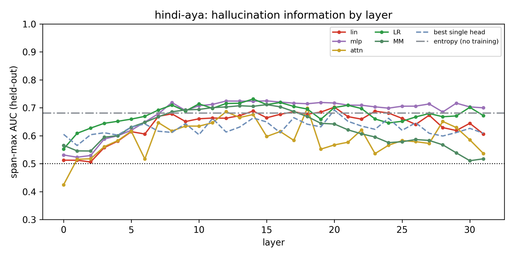

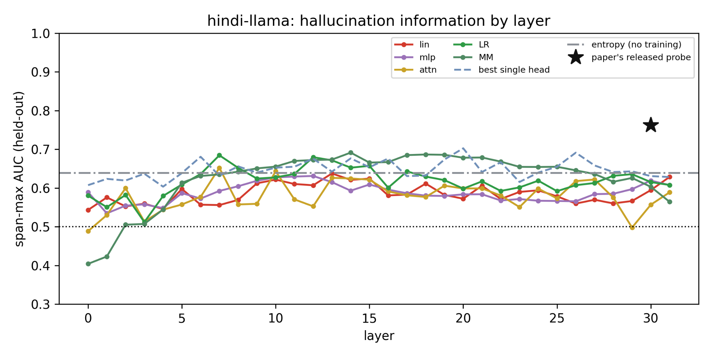

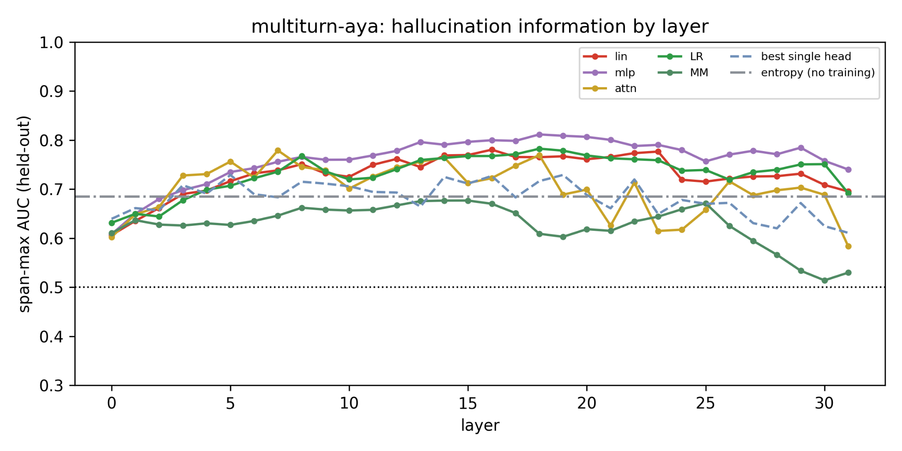

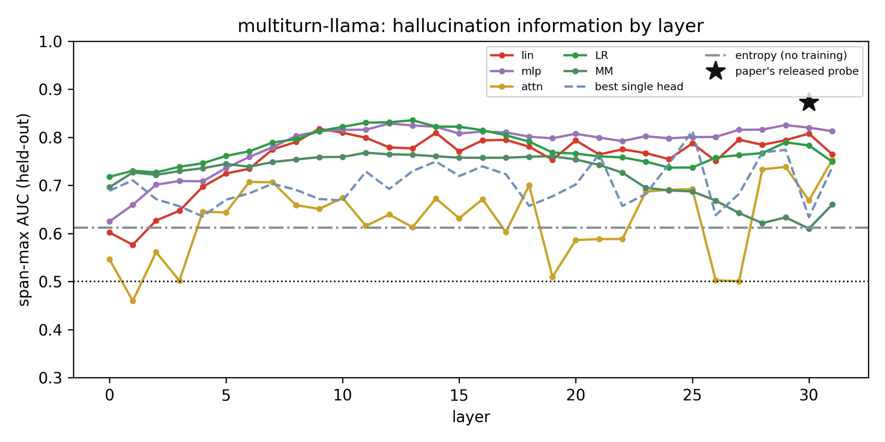

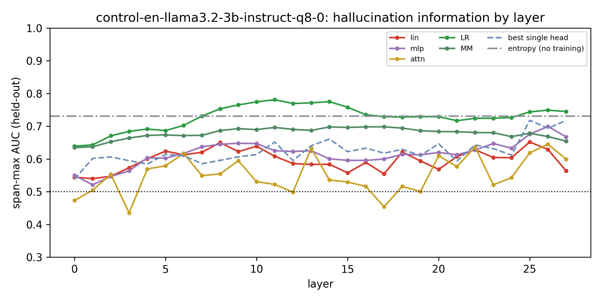

*Figure C3. Held-out span-max AUC at every layer for each detector, per run. The dashed line is the best single attention head at that layer; the dash-dot line is next-token entropy (no training); the star is the paper’s pretrained probe (Llama only).*

In every run, detection is weakest in the first few layers and levels off from the middle layers onward. The plateaus differ by run:

- **Hindi Aya:** the MLP probe stays around 0.70–0.72 from layer 12 to the last layer. Several detectors sit only slightly above entropy (0.68).

- **Hindi Llama:** most layers stay between 0.55 and 0.69, and difference of means is the most stable detector. The pretrained probe at layer 30 (0.76) sits clearly above all of them.

- **Multi-turn:** probes reach about 0.80 (Aya, MLP, layers 13–22) and about 0.83 (Llama, layers 9–14).

- **English control:** logistic regression clearly leads, peaking at 0.78 at layer 11.

- **Across runs:** the attention-layer probe is the least stable from layer to layer.

**C.4 Probes on individual attention heads**

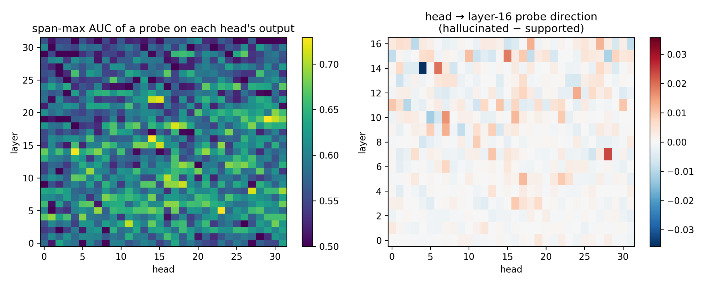

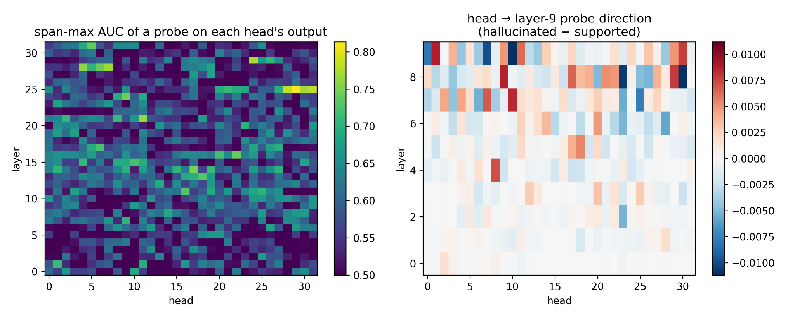

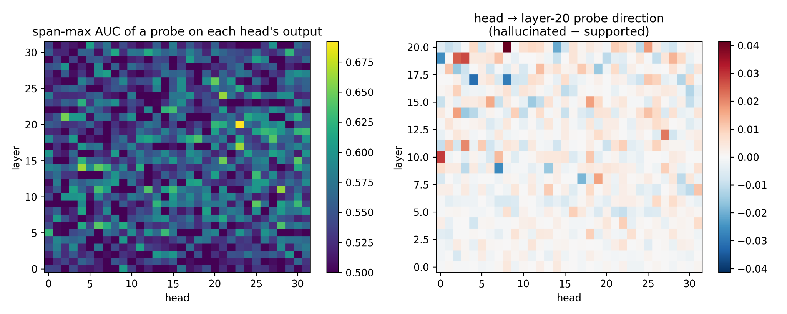

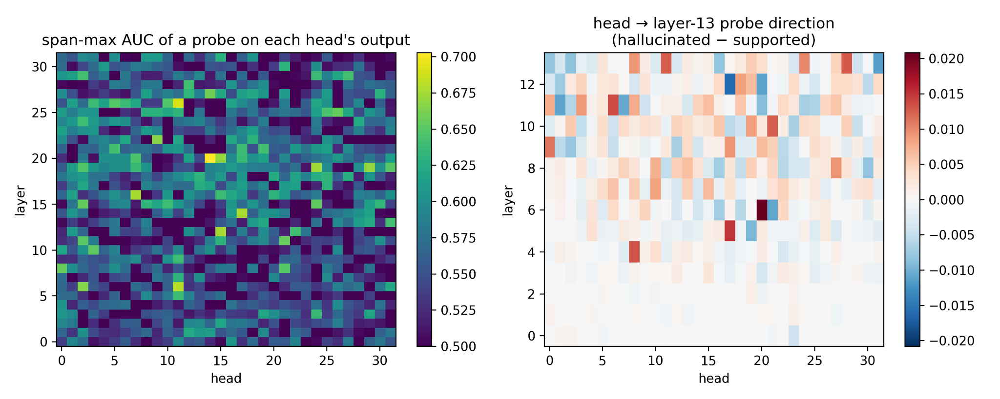

*Figure C4. Left: span-max AUC of a probe trained on each attention head’s output (layer × head). Right: each head’s contribution along the best-layer linear probe direction (hallucinated minus supported).*

No single head comes close to the layer-wide probes in the Hindi runs: the best heads reach about 0.69 (Aya) and 0.70 (Llama), and they’re scattered across layers. Multi-turn Llama is the exception, with a few late heads (around layer 25) reaching about 0.8. The signal is spread across many heads rather than concentrated in a few.

**C.5 Where entity tokens attend**

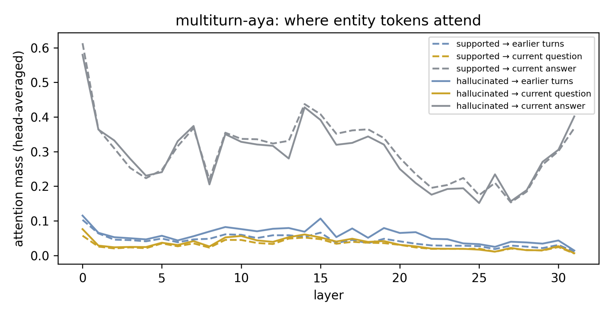

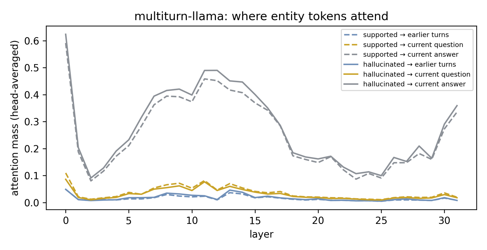

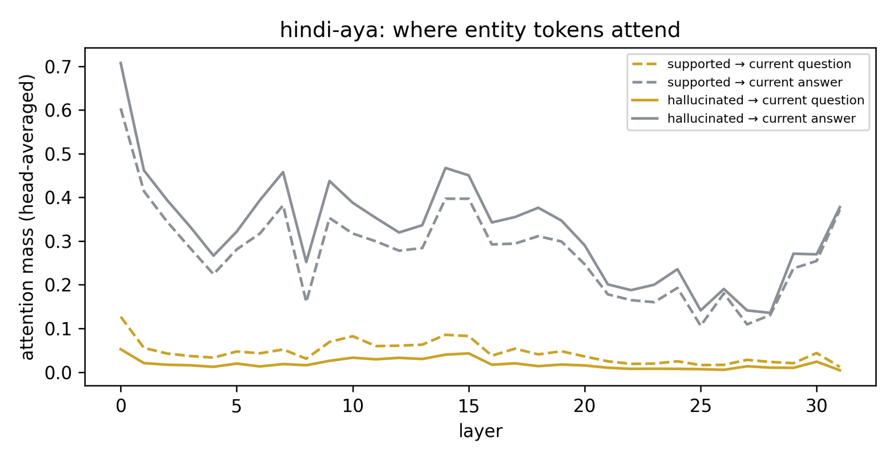

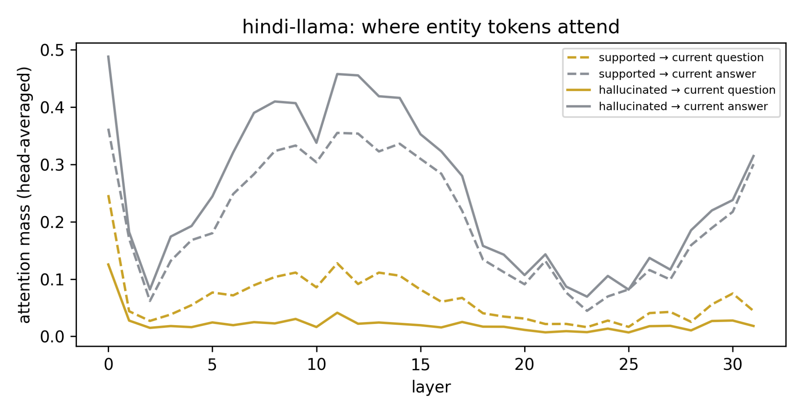

*Figure C5. Head-averaged attention from entity tokens to the current question, the current answer, and (multi-turn only) earlier turns, split by hallucinated (solid) vs supported (dashed) entities.*

In both Hindi runs, hallucinated entities attend more to the answer written so far and less to the question than supported entities do, across most layers. The gap is clearest in Llama’s layers 5–17. In multi-turn conversations the difference is small. For Aya, hallucinated entities attend slightly more to earlier turns in the middle layers; for Llama they attend slightly more to the current answer in layers 7–15. This matches the head-level correlations in Figure C1, but it’s an association, not evidence of a cause.

**C.6 Linear probe by relative depth: English vs Hindi**

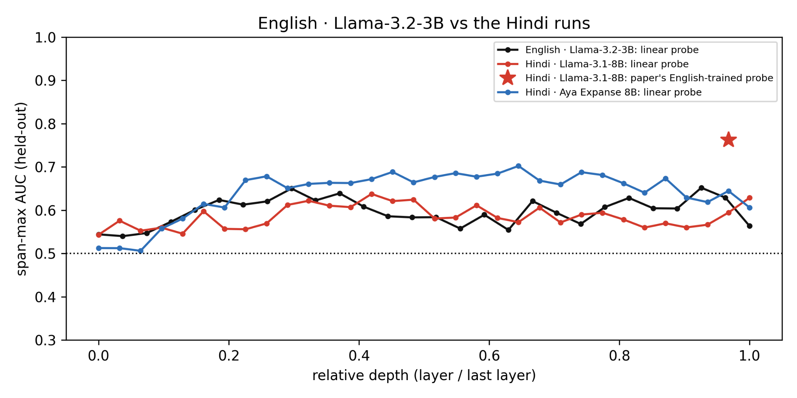

*Figure C6. Linear-probe AUC against relative depth for the English control and the two Hindi runs, with the pretrained probe on Hindi Llama (star).*

The linear probe never clearly exceeds 0.70 at any depth in any of the three runs. The pretrained English probe on Hindi Llama (0.76) is above all of them.

**C.8 Attention patterns of the top heads**

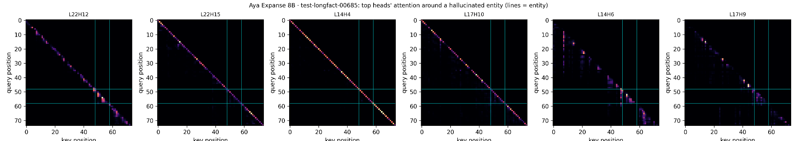

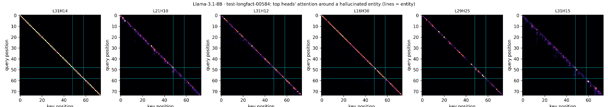

*Figure C8. Attention patterns of the six heads in Figure C1 around one hallucinated entity (lines mark the entity).*

Most of these heads attend almost entirely to the current or immediately preceding token: the diagonal pattern typical of local, position-based heads. A few (for example Aya’s L14H6 and L17H9) also attend back to earlier positions around the entity. This is a single example per model, so read it as illustration, not evidence.

**C.9 Steering diagnostics: sweep, neurons and head correlations**

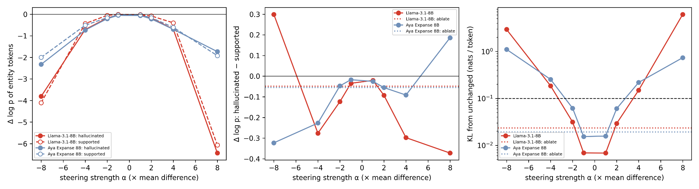

*Figure C9. Steering sweep on the existing Hindi answers, against steering strength α: change in log-probability of hallucinated and supported entity tokens (left), hallucinated minus supported (middle), and KL divergence from the unmodified model in nats per token (right, log scale; dashed line at 0.1). Dotted lines are the ablated direction.*

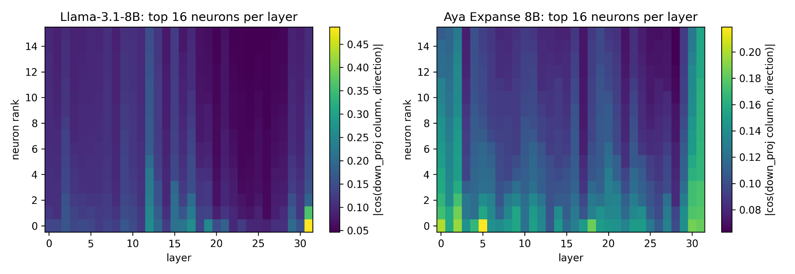

*Figure C10. Top 16 MLP neurons per layer, ranked by the absolute cosine between their mlp.down_proj output column and the hallucination direction. Left: Llama 3.1 8B; right: Aya Expanse 8B.*

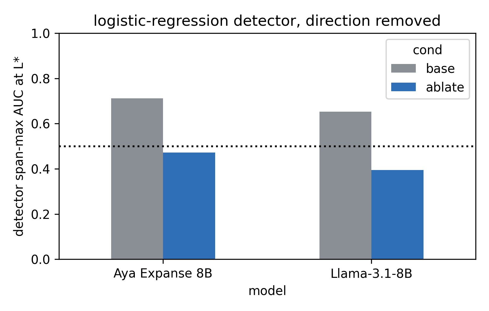

*Figure C11. Span-max AUC of the logistic-regression detector at the direction's layer before (grey) and after (blue) removing the direction. Same values as the right-hand side of Figure 8.*

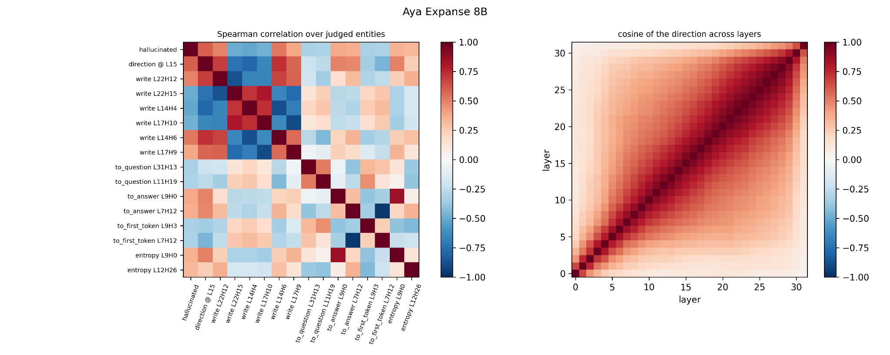

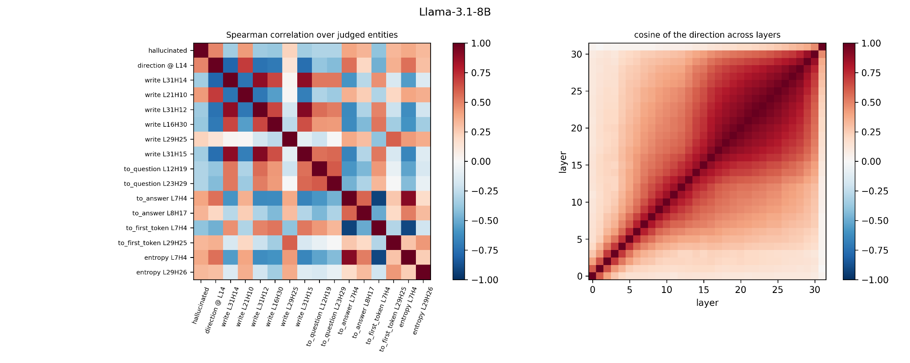

*Figure C1. Left: Spearman correlation, over judged entities, between the judge label, the projection onto the direction and features of the top heads (their write along the direction, attention to the question, the answer and the first token, and attention entropy). Right: cosine similarity of the direction between layers. Top: Aya Expanse 8B; bottom: Llama 3.1 8B.*

In both models the judge label correlates most with the projection onto the direction (Spearman 0.60 for Aya, 0.49 for Llama). The writes of individual heads along the direction come next (up to about 0.5 for Aya and 0.4 for Llama), attention to the question is negatively correlated with hallucination and attention to the answer so far positively, matching Figure C5. The cosine maps show that the direction changes gradually from layer to layer, so neighbouring layers share most of it.

## LLM Usage Statement
Parts of the code used for building this project have been generated using llms and llms was used to brainstorm and filter down ideas in the ideation phase, for literature review and to generate ideas for the report which is written entirely by us and appendix was polished and parts of caption were written using llms
